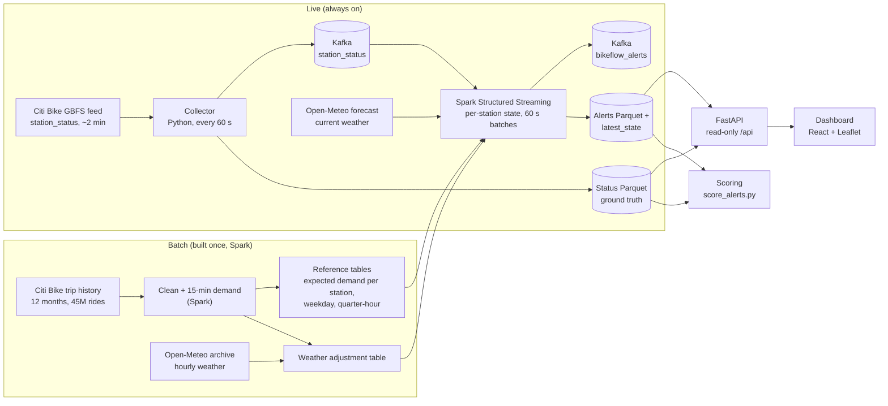
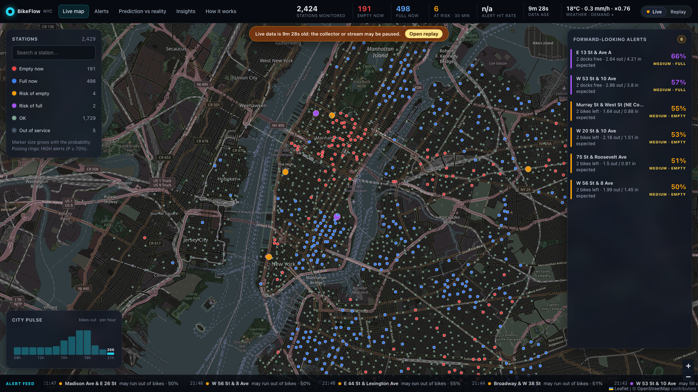
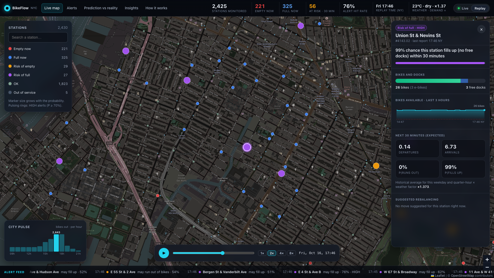
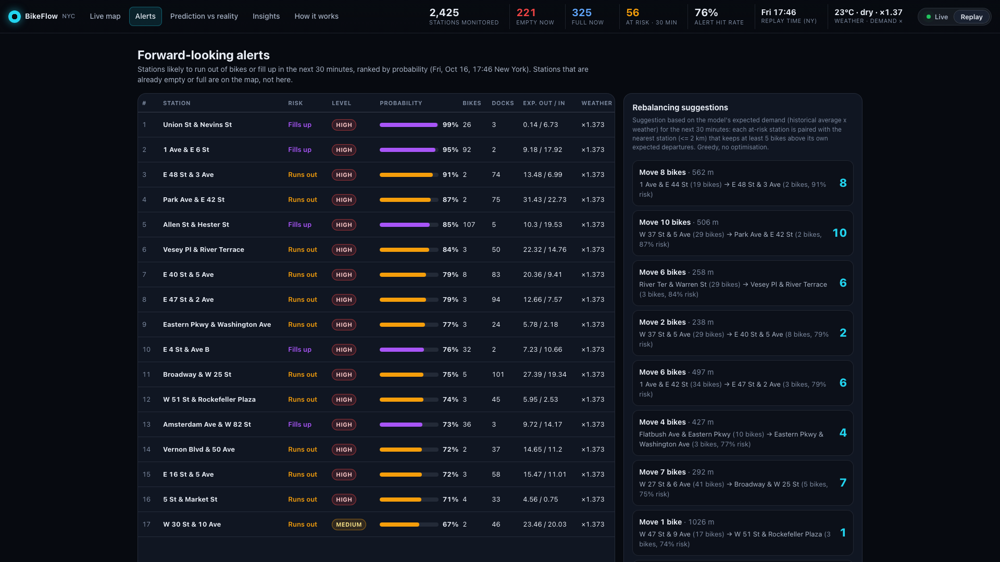
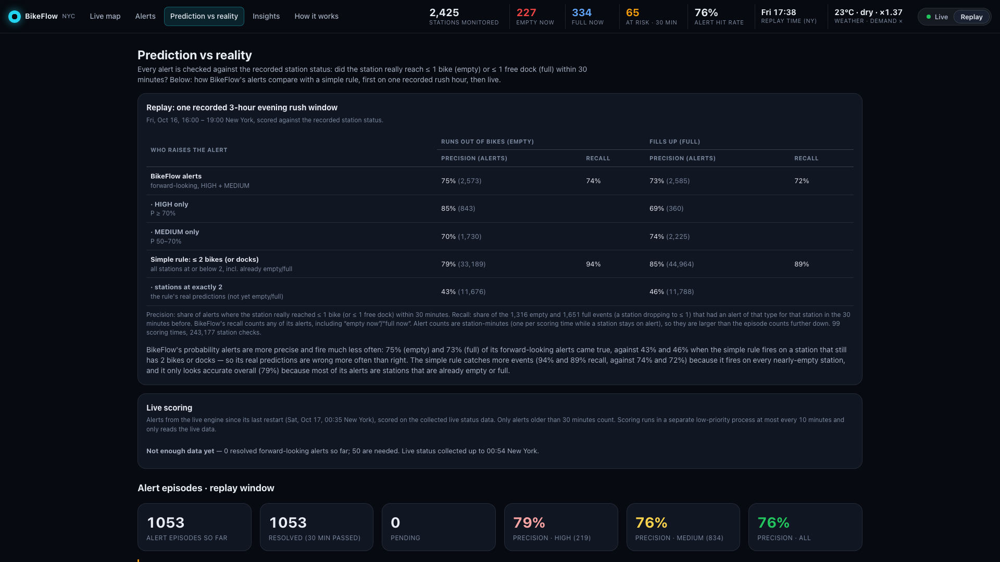
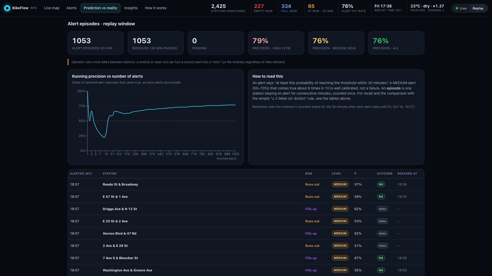
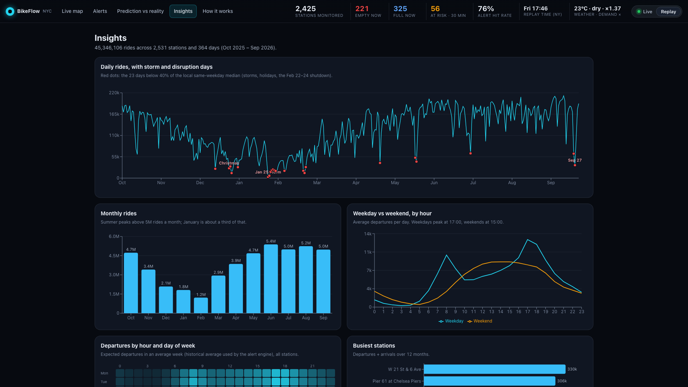
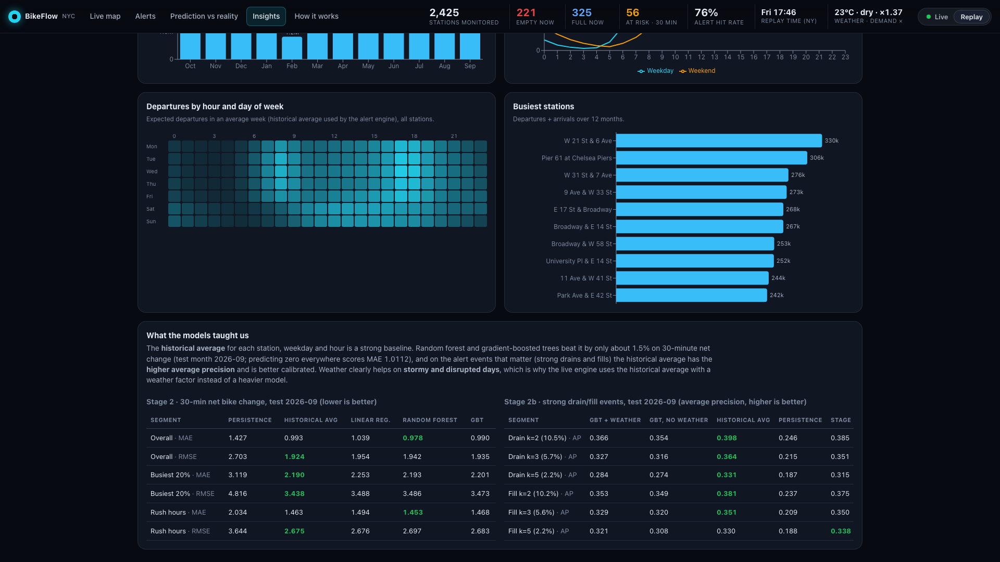
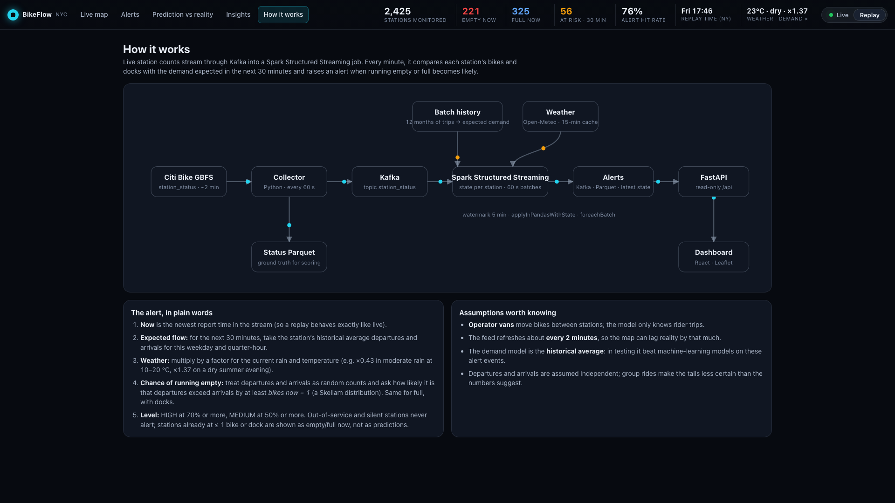

# BikeFlow

**Real-time bike-share risk alerts for New York City: which Citi Bike stations are about to run out of bikes or docks in the next 30 minutes.**


-231F20?logo=apachekafka&logoColor=white)


---

## Contents

1. [The project in two minutes](#1-the-project-in-two-minutes)
2. [Why this is a big data and streaming project](#2-why-this-is-a-big-data-and-streaming-project)
3. [Architecture](#3-architecture)
4. [Data sources and cleaning](#4-data-sources-and-cleaning)
5. [Method](#5-method)
6. [Results](#6-results)
7. [Dashboard tour](#7-dashboard-tour)
8. [How to run it](#8-how-to-run-it)
9. [Repository structure](#9-repository-structure)
10. [Limitations and assumptions](#10-limitations-and-assumptions)
11. [Future work](#11-future-work)
12. [Glossary](#12-glossary)

---

## 1. The project in two minutes

**The problem.** A bike-share station is only useful when it has a bike to rent *and* a free dock to return one. In New York, Citi Bike stations empty out near homes in the morning and fill up near offices, then the flow reverses in the evening. A rider who arrives at an empty station has to walk to another one; a rider who can't find a free dock is stuck circling the block.

**Who cares.**
- **Riders** want to know whether the station they are heading to will still have a bike.
- **Operators** send vans to move bikes from full stations to empty ones, and want to know *where* to send them *before* the problem happens.

**What BikeFlow does.** I built a pipeline that:

1. **learns** how busy every station normally is, from 12 months of trip history (45 million rides);
2. **watches** every station live through the public Citi Bike feed;
3. **estimates**, every minute, the chance that each station runs out of bikes or docks in the next 30 minutes, adjusted for the current weather;
4. **shows** the result on a live map with ranked alerts and simple "move N bikes from A to B" suggestions;
5. **checks itself**: every alert is later compared with what actually happened.

The honest headline: on a recorded weekday evening rush, **about 3 in 4 of BikeFlow's forward-looking alerts came true**. A simple "alert when a station has 2 or fewer bikes" rule catches more events, but when it fires on a station that still has 2 bikes it is right **less than half the time** ([results](#63-alert-quality-on-a-recorded-rush-hour)).

---

## 2. Why this is a big data and streaming project

| | scale |
|---|---|
| Trip history | **45,384,105** raw rides → **45,347,219** clean, 12 months (Oct 2025 – Sep 2026), about 1 GB of CSV per summer month |
| Stations | **2,531** stations in the trips, **2,518** in the live feed, **2,477** matched and modelled |
| Demand table | **28,506,950** station × 15-minute rows |
| Model feature table | about **73 million** rows (one per station per 15 minutes, Nov 2025 – Sep 2026) |
| Live feed | about 2,500 station records every ~2 minutes, about **22.5 MB/day** of collected status |

All of it runs on one **8 GB laptop**, which shaped most design choices: everything is processed one month at a time, Spark jobs are capped at 2–3 GB, and memory and disk are checked before every step.

**Which tool does what**

| tool | job in BikeFlow |
|---|---|
| **Apache Spark (PySpark)** | Batch: cleans 45M trips, builds the 15-minute demand table, features and reference tables, trains the Stage 2 models (MLlib). |
| **Apache Kafka** (single node, KRaft) | Carries live station updates (`station_status` topic) and the alerts (`bikeflow_alerts`). Decouples the collector from the stream job. |
| **Spark Structured Streaming** | Reads Kafka, keeps per-station state (`applyInPandasWithState`, 5-minute watermark), and every 60-second micro-batch computes the alert probabilities. |
| **Python collector** | Polls the Citi Bike GBFS feed every 60 seconds and writes Parquet (the ground truth) and Kafka messages. |
| **SciPy** | The Skellam distribution behind the alert probability. |
| **Open-Meteo** | Hourly historical weather for training; current weather for the live weather factor (no API key). |
| **FastAPI + React + Leaflet** | Read-only API and the dashboard. |

---

## 3. Architecture



- **Trip history → Clean + demand (Spark):** downloads each month, converts it to Parquet one file at a time, cleans it and aggregates departures and arrivals per station per 15 minutes.
- **Reference tables:** the historical average number of departures and arrivals for each station, weekday and quarter-hour. This is the demand model the live engine uses.
- **Weather adjustment table:** how much demand rises or falls in each combination of rain and temperature, learned from the 12 months of trips and hourly weather.
- **Collector:** a small Python process (about 78 MB of memory) that polls the live feed, skips unchanged stations and writes both Parquet and Kafka.
- **Kafka:** the buffer between the collector and Spark. Either side can restart without losing the other's data, and the same topic can be filled from a recording (replay) instead of the live feed.
- **Spark Structured Streaming:** keeps the last 35 minutes of every station in state, and once a minute turns current bikes and docks plus expected demand into probabilities.
- **Alerts Parquet / latest_state / Kafka alerts:** the outputs. The dashboard reads the files; other consumers could subscribe to the topic.
- **Scoring:** compares every alert with the recorded status 30 minutes later.
- **FastAPI + Dashboard:** read-only views over all of the above, with a replay mode for recorded data.

Details: [`docs/streaming_notes.md`](docs/streaming_notes.md), [`docs/collector_notes.md`](docs/collector_notes.md), [`docs/dashboard_notes.md`](docs/dashboard_notes.md).

---

## 4. Data sources and cleaning

**Sources**
- **Citi Bike trip history** (public S3 bucket `tripdata`): one zip per month, 13 columns per ride (ride id, bike type, start/end time, start/end station name, id and coordinates, member type).
- **Citi Bike GBFS feed** (public, no key): `station_status` (bikes, docks, flags, last report time) and `station_information` (names, coordinates, capacity).
- **Open-Meteo** (public, no key): hourly temperature, precipitation and wind for New York; archive for training, forecast for live.

**Cleaning.** Each month is downloaded, converted and cleaned on its own, then verified: the written row count must equal the number of distinct surviving ride ids before the raw copy is deleted. The data arrives almost clean; the rules removed **0.08 %** of rows:

| rule | rows removed |
|---|---:|
| invalid timestamps | 0 |
| end before start | 482 |
| ride longer than 24 h | 10,284 |
| no start station (dockless e-bike starts) | 26,120 |
| duplicate ride id within a month | 0 |

119,968 rides (0.26 %) have no end station; they are kept and flagged.

**Data-quality findings worth knowing** (full detail in [`docs/data_notes.md`](docs/data_notes.md))
- **Station ids that lost their trailing zero.** Ids look like decimals (`5980.10`), and some rows carry them as `5980.1`, in every month: 651,570 end ids and 96,479 start ids. Left alone, one station appears under two ids and its demand is split. The live feed has the same defect in a few ids. Both sides are repaired the same way. On the first 3 months this alone raised the match rate to the live feed from 95.5 % to 99.1 %.
- **New York time zone.** Trip times are local New York time, and my laptop runs on a different time zone. Two bugs came from that: month boundaries computed in the host time zone (9.5 hours off), and timestamps rendered in the host time zone in reports. Everything is now computed in `America/New_York` inside Spark, and that is documented.
- **Monthly files are split by end time, except one.** Every file holds the rides that *ended* that month; April 2026 is cut by *start* time, so **495 rides** appear in both the April and May files. They are kept as a documented limitation; the demand table counts them once.
- **Storm and disruption days.** On 23 Feb 2026 the system recorded zero rides: a shutdown of about 34 hours. February was first quarantined, then included with the shutdown flagged. In total **23 days** are flagged as disrupted (rides below 40 % of the median of the same weekday within ±4 weeks: storms, holidays and the shutdown). A year-wide median would have flagged 50 ordinary winter days instead, so the comparison is local.
- **Station mapping.** 2,477 of 2,531 trip stations (97.9 %, 98.4 % of trips) match the live feed. The rest were retired or renumbered during the year.

---

## 5. Method

### Expected demand
For every station, weekday and quarter-hour (New York time), I take the average number of departures and arrivals over the 12 months, excluding disrupted days. Quarter-hours with no rides count as zeros, so quiet stations are not overstated. That gives 2,477 stations × 672 weekly slots = 1,664,544 expected values.

### The weather factor
Expected demand is a year-round average, so it needs a correction for the conditions right now. From the 12 months, I measured actual ÷ expected rides for each combination of rain (none / light / moderate / heavy) and temperature band, and smoothed thin cells. Examples:

| conditions | departure factor |
|---|---:|
| dry, below 0 °C | 0.39 |
| dry, 10–20 °C | 1.15 |
| light rain, 10–20 °C | 0.76 |
| moderate rain, 10–20 °C | 0.43 |
| dry, 20–28 °C | 1.37 |

Temperature also carries the season: the year-round average needs to go *up* on a warm dry evening and *down* on a cold one.

### The alert probability, in plain words
Every minute, for every station:

1. **Now** is the newest report time in the stream (so a replay of recorded data behaves exactly like live).
2. **Expected flow:** take the station's expected departures and arrivals for the next 30 minutes and multiply them by the weather factor.
3. **Chance of running empty:** treat departures and arrivals as random counts (Poisson). The difference between two such counts follows a **Skellam distribution**, so I can compute the chance that departures exceed arrivals by at least *bikes now − 1* within 30 minutes. The same calculation with docks gives the chance of filling up.
4. **Level:** **HIGH** at 70 % or more, **MEDIUM** at 50 % or more. Out-of-service and silent stations never alert. Stations already at ≤ 1 bike or dock are shown as "empty now" / "full now", not as predictions.

### Why the historical average is the production model
I trained machine-learning models first (linear regression, random forest and gradient-boosted trees in Spark MLlib, then gradient-boosted models for departures and arrivals with weather). They improved count accuracy slightly but **did not beat the historical average on the events that alerts are about**, and they were worse calibrated (when they said 85 %, the event happened about 70 % of the time). The historical average is simple, explainable, cheap to run in a stream, and well calibrated, so it is the production baseline; weather enters as a factor, where it clearly helps. Full write-up: [`docs/model_notes.md`](docs/model_notes.md).

---

## 6. Results

### 6.1 Stage 2: predicting the 30-minute net change in bikes
Test month September 2026, disrupted days excluded, every row scored (MAE / RMSE, bikes over the next 30 minutes; lower is better). Models trained on a 20 % station-day sample (10,771,345 rows).

| segment | always 0 | persistence | historical avg | linear reg. | random forest | GBT |
|---|---|---|---|---|---|---|
| overall | 1.011 / 2.215 | 1.427 / 2.703 | 0.993 / **1.924** | 1.039 / 1.954 | **0.978** / 1.942 | 0.990 / 1.935 |
| busiest 20 % of stations | – | 3.119 / 4.816 | **2.190 / 3.438** | 2.253 / 3.488 | 2.193 / 3.486 | 2.201 / 3.473 |
| rush hours | – | 2.034 / 3.644 | 1.463 / **2.675** | 1.494 / 2.676 | **1.453** / 2.697 | 1.468 / 2.683 |

The best model (random forest) beats the historical average by only 1.5 % on MAE, is worse on RMSE, and does not beat it at the busiest stations.

### 6.2 Stage 2b: event probabilities with weather
Average precision for strong drain/fill events (k = 3 bikes in 30 minutes; test month, disrupted days excluded; higher is better):

| event | base rate | GBT + weather | GBT, no weather | historical avg | Stage 2 net model | persistence |
|---|---:|---:|---:|---:|---:|---:|
| strong drain (k = 3) | 5.7 % | 0.327 | 0.316 | **0.364** | 0.351 | 0.215 |
| strong fill (k = 3) | 5.6 % | 0.329 | 0.320 | **0.351** | 0.350 | 0.209 |

Poisson deviance for departures (lower is better): GBT + weather **1.395**, historical average 1.415, no-weather GBT 1.430 on the test month. On the validation month the historical average was better (1.381 vs 1.418). On **disrupted (stormy) days** the weather model is clearly better: 0.957 vs 1.195 for the historical average and 1.260 without weather.

**What I take from this:**
- **The historical average is a strong baseline.** No model I trained beat it on the alert events.
- **Weather helps most on stormy days.**
- **Both findings shaped the live engine:** historical average × weather factor.

### 6.3 Alert quality on a recorded rush hour
Scored on **one recorded 3-hour evening rush window** (Fri 16 Oct 2026, 16:00–19:00 New York), replayed through the same streaming engine. Each alert is checked against the recorded status: did the station reach ≤ 1 bike (or ≤ 1 free dock) within 30 minutes? (`outputs/metrics/replay_alert_scores.json`)

| who raises the alert | empty: precision | empty: recall | full: precision | full: recall |
|---|---:|---:|---:|---:|
| **BikeFlow** forward-looking alerts (HIGH + MEDIUM) | **75 %** (2,573) | 74 % | **73 %** (2,585) | 72 % |
| · HIGH only | 85 % (843) | | 69 % (360) | |
| · MEDIUM only | 70 % (1,730) | | 74 % (2,225) | |
| simple rule: ≤ 2 bikes (or docks), all | 79 % (33,189) | **94 %** | 85 % (44,964) | **89 %** |
| · stations at exactly 2 (its real predictions) | 43 % (11,676) | | 46 % (11,788) | |

Alert counts are station-minutes. Events: 1,316 stations dropping to ≤ 1 bike, 1,651 to ≤ 1 dock.

**The trade-off:**
- **BikeFlow's alerts are more precise and fire far less often.** About 3 in 4 come true.
- **The simple rule catches more events, but its real predictions are wrong more often than right.** It only looks accurate overall because most of its alerts are stations that are already empty or full.
- **Counted as episodes** (one station staying on alert counts once), the same window has 1,053 alert episodes, 76 % of which came true (HIGH 79 %, MEDIUM 76 %).
- **This is one rush hour**, not a full evaluation.

Recall depends on the window: an earlier one-hour afternoon test caught about half of the events, so treat the rush-hour recall as a best case until the live run reports across more hours.

### 6.4 Live results
**To be updated after the live run.** The live engine scores its own alerts against the collected live status (alerts older than 30 minutes only, from the last restart); the dashboard's *Prediction vs reality* page shows these numbers once at least 50 alerts have been resolved.

### 6.5 Engineering numbers
- **Batch:**
  - features take about 1 minute per month;
  - the weather GBT fits took 20.5 and 18.5 minutes on the 8 GB laptop;
  - all jobs stayed under 3 GB.
- **Streaming:** in a 58-minute replay test, micro-batches averaged 3.4 s against a 60 s trigger, and Spark used at most 1.21 GB.
- **Collector:** about 980 ms average fetch latency and about 22.5 MB of status per day.
- **Dashboard:** every page loads in under 2 s, and the full map runs at about 58–60 fps in Chrome.

---

## 7. Dashboard tour

**Live map.** All stations on one canvas, coloured by status (red empty now, blue full now, orange risk of empty, purple risk of full, grey-green ok). Pulsing rings mark HIGH alerts. The panels show filters and search, ranked alerts, the "city pulse" (bikes out on the street per hour) and a ticker of the newest alerts. A banner appears when live data is more than 5 minutes old.


**Replay mode.** A time slider with play, pause and speed controls scrubs through a recorded rush hour, and the map and KPIs update as it plays. It's the demo mode when the live feed is quiet.


**Station drawer.** Bikes and docks gauge, a 3-hour sparkline, expected departures and arrivals for the next 30 minutes, the probability as a sentence ("99% chance this station fills up…"), the weather factor and a suggested move.


**Alerts.** Ranked forward-looking alerts with probability bars, plus greedy rebalancing suggestions ("move N bikes from A to B, X m away"), labelled as suggestions based on expected demand.


**Prediction vs reality.** Precision and recall of BikeFlow's alerts against the simple rule, first on the recorded rush hour, then live since the last restart ("not enough data yet" until 50 alerts are resolved). Below that, every alert episode with hit or miss.



**Insights.** Daily rides with storm days marked, monthly rides, weekday vs weekend hourly profile, a departures heatmap, busiest stations, and the model comparison tables.



**How it works.** An animated architecture diagram and the alert formula in plain words.


---

## 8. How to run it

### Prerequisites
- **macOS or Linux, 8 GB of RAM**, and about **10 GB of free disk** for the 12 months. Every step checks free disk and stops below 4 GB.
- **Java 17** (Spark). On macOS: `brew install openjdk@17`. The code finds it, so there is no need to change `JAVA_HOME`.
- **Python 3.11.**
- **Node 18+** (dashboard; built with Node 22).
- **Kafka 4.x**: `brew install kafka`.

```bash
python3.11 -m venv .venv
.venv/bin/pip install -r requirements.txt -r backend/requirements.txt
(cd frontend && npm install)
```

8 GB notes: Spark runs with `local[2–3]` and a 2–3 GB driver; months are processed one at a time; the Kafka broker heap is capped at 512 MB; each Spark job uses its own scratch folder under `data/tmp_spark/`.

### 1. Batch pipeline (once)
```bash
.venv/bin/python scripts/download_trips.py --latest 12   # download, convert, clean, verify month by month
.venv/bin/python -m src.clean --include 2026-02          # only if a month was quarantined and you accept it
scripts/build_features.sh                                # stations, 15-min demand, data-quality summary
scripts/run_stage2.sh                                    # optional: Stage 2 models and charts
scripts/run_stage2b.sh                                   # optional: weather, flow models, event evaluation
.venv/bin/python -m src.collector --once                 # one live poll (station_information for the next step)
.venv/bin/python -m src.reference_tables                 # expected demand + weather adjustment for the live engine
```

### 2. Live system
```bash
scripts/start_kafka.sh                 # single-node Kafka (KRaft), creates the topics
scripts/run_collector.sh --kafka       # collector: Parquet + Kafka, keeps the Mac awake while it runs
scripts/start_stream.sh                # Spark Structured Streaming alert engine (60 s micro-batches)
scripts/start_dashboard.sh             # http://127.0.0.1:5173 (API on :8000)
```

### 3. Replay mode (demo without the live feed)
```bash
scripts/make_replay.sh                 # busiest recorded 3-hour window, separate topics and output
```
Then switch the dashboard to **Replay**.

### Stop everything (reverse order)
```bash
scripts/stop_dashboard.sh
scripts/stop_stream.sh
scripts/stop_collector.sh
scripts/stop_kafka.sh
```

### Restart-safe behaviour
- **The collector** saves its de-duplication state, so a restart simply continues appending.
- **The alert engine** resumes from its Spark checkpoint and reloads the last station state.
  - If the checkpoint is incompatible (a newer state version), `start_stream.sh` moves it aside (never deletes it) and retries once.
  - On a failed start, it prints the first error and the last 15 log lines.
- **Kafka** keeps 24 hours of messages in `data/kafka/`.
- **Every script refuses to start a second copy** of a running process.

---

## 9. Repository structure

```
BikeFlow/
├── src/                     # all Python logic
│   ├── ingest.py, clean.py, stations.py, aggregate_demand.py   # batch: trips → clean → demand
│   ├── build_features.py, train_model.py, eval_alerts.py      # Stage 2 models (MLlib)
│   ├── weather.py, train_flow.py, eval_flow.py                 # Stage 2b: weather, flow models, Skellam evaluation
│   ├── reference_tables.py, weather_live.py                    # live engine inputs
│   ├── collector.py, live_map.py                               # live GBFS collector
│   ├── replay.py, replay_window.py                             # replay recorded data into Kafka
│   ├── stream_alerts.py, score_alerts.py                       # Structured Streaming engine + scoring
│   └── common.py                                               # Spark session, disk/memory guards, paths
├── scripts/                 # start/stop scripts and pipeline runners (fail-fast)
├── backend/app/             # FastAPI read-only API
├── frontend/                # React + Vite + Leaflet dashboard
├── config/kafka/            # Kafka KRaft config template
├── models/                  # saved models, station index, baseline tables
├── outputs/metrics/         # every result quoted in this README (JSON)
├── outputs/charts/          # batch and model charts
├── docs/                    # data, model, collector, streaming, dashboard notes + screenshots
├── tests/                   # Spark-free tests for the alert engine
└── data/                    # (git-ignored) raw, processed, live, Kafka, checkpoints
```

---

## 10. Limitations and assumptions

- **US data, one city.** Everything is learned from New York Citi Bike data (Oct 2025 – Sep 2026). Weather is a single point for the whole city.
- **The live feed refreshes about every 2 minutes** (despite a 60-second TTL), so the map can lag reality by that much.
- **Operator vans.** Rebalancing trucks move many bikes at once. The model only knows rider trips, so a restock can turn a correct alert into a "miss" and the reverse.
- **Poisson independence.** Departures and arrivals are treated as independent random counts. Group rides and commute waves make real counts burstier, so tail probabilities are optimistic.
- **The collector only runs while the machine is awake.** A sleeping laptop leaves gaps in the live data.
- **New stations** that opened after the trip year (41 in the live feed) have no history and get no alerts until the reference tables are rebuilt.
- **Known data limitation:** 495 rides appear in both the April and May 2026 files (documented, counted once in demand).
- **The ML models did not beat the historical average** on alert events. The production engine is deliberately simple.
- **Map tiles** are standard OpenStreetMap tiles, which suit light use only.

---

## 11. Future work

- **Count-aware models:** try Poisson or quantile objectives and probability recalibration on top of the historical average.
- **Detect rebalancing vans** from sudden jumps in station counts, and exclude them from scoring.
- **Optimise rebalancing routes** for a fleet of vans, instead of the current greedy nearest-donor suggestion.
- **Add an events and holiday calendar** (concerts, parades, school holidays) as a demand factor.
- **Keep the reference tables fresh** by rebuilding them monthly as new trip data is published.
- **Deploy it:** containers, a hosted Kafka, and push notifications for HIGH alerts.
- **Run it for weeks** and report live precision and recall across mornings, nights, weekends and rain.

---

## 12. Glossary

- **GBFS (General Bikeshare Feed Specification):** the public JSON format bike-share systems use to publish live station data (bikes, docks, station info).
- **Kafka:** a message log. Producers append messages to a *topic*, and consumers read them at their own pace. If one side stops, the other keeps its place.
- **Spark Structured Streaming:** Spark's engine for continuous data. It treats a stream as a table that keeps growing, and processes it in small steps.
- **Micro-batch:** one small step of a streaming job. Here, everything that arrived in the last 60 seconds, processed together.
- **Watermark:** how late an event may arrive and still be counted (5 minutes here).
- **Skellam distribution:** the distribution of the difference between two independent Poisson counts. Here, departures minus arrivals.
- **Precision:** of the alerts raised, the share that came true.
- **Recall:** of the events that happened, the share that had an alert beforehand.
- **Baseline:** a simple reference method that a model has to beat. Here: "the last 30 minutes repeat", "the historical average", or "≤ 2 bikes".

---

Built by Manas Jadhav
