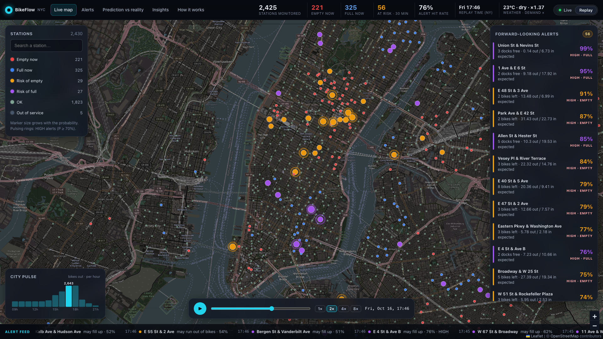

# Dashboard notes (Stage 4)

A read-only "control room" for the alert engine: a FastAPI backend over the files the
stream already writes, and a React + Vite + Leaflet frontend. It never writes to `data/live`.



## Start and stop

```bash
scripts/start_dashboard.sh     # backend http://127.0.0.1:8000, frontend http://127.0.0.1:5173
scripts/stop_dashboard.sh
scripts/make_replay.sh         # (re)build the replay/demo data, see below
.venv/bin/python scripts/dashboard_e2e.py   # headless test: screenshots + smoothness + memory
```

- **Where its own files go:** PIDs and logs in `data/dashboard/` (git-ignored).
- **Frontend:** the Vite dev server, with no build step needed. It proxies `/api` to the backend,
  so the browser only talks to :5173.
- **Requirements:** the backend needs `fastapi` and `uvicorn` (`backend/requirements.txt`, installed
  in `.venv`). The frontend needs Node 18+ and `npm install` in `frontend/`; the start script runs it
  if `node_modules` is missing.

## Pages

| page | what it shows |
|---|---|
| **Live map** | All ~2,500 stations on one Leaflet canvas, coloured by status (red empty now, blue full now, orange risk of empty, purple risk of full, grey-green ok); size grows with probability; pulsing rings only on HIGH alerts. Floating panels: filters + search (left), ranked forward-looking alerts (right, click = fly to station), city pulse (bottom left), alert ticker (bottom), replay controls (bottom centre, Replay mode). Click a station for the drawer: bikes/docks gauge, 3-hour sparkline from the recorded status, expected departures/arrivals for the next 30 min, P(empty)/P(full) with a plain sentence, weather factor, suggested move. |
| **Alerts** | Ranked table of forward-looking alerts (virtualized) with probability bars, and greedy rebalancing suggestions ("Move N bikes from A to B, X m away"). |
| **Prediction vs reality** | (1) **Replay scoring**, "one recorded 3-hour evening rush window": precision and recall of BikeFlow's forward-looking alerts vs the simple rule "≤ 2 bikes (or docks)", from `outputs/metrics/replay_alert_scores.json` (exact window, `src/score_alerts.py --since`). (2) **Live scoring**: the live engine's alerts since its last restart, scored by `src/score_alerts.py --since-restart` in a separate low-priority process (at most every 10 min; reads `data/live`, writes `data/dashboard/live_alert_scores.json`); shows "not enough data yet" below 50 resolved alerts. (3) Alert episodes with hit/miss, running precision for HIGH and MEDIUM, precision vs number of alerts. Caveat: operator vans change outcomes. |
| **Insights** (lazy-loaded) | Daily rides with storm/disruption days marked, monthly rides, weekday vs weekend hourly profile, departures heatmap by hour × weekday, busiest stations, and the Stage 2 / 2b model comparison tables with an honest summary. |
| **How it works** | Animated architecture diagram (collector → Kafka → Spark Structured Streaming → alerts → API → dashboard, with the batch history and weather feeding Spark) and the alert formula in plain words. |

- **Refresh:** the KPI strip and every live view poll the API every 30 seconds.
- **Stale banner:** an amber banner (with a button to open Replay) appears when live data is more
  than 5 minutes old.

## API (read-only, `backend/app/`)

Endpoints with live data accept `?source=live` (default) or `?source=replay`. Replay endpoints also
take `?at=<ISO time>`, which drives the time slider.

| endpoint | content |
|---|---|
| `GET /api/state` | Every station's latest state: bikes, docks, status (`ok`/`empty_now`/`full_now`/`risk_empty`/`risk_full`/`out_of_service`), probability, level, expected demand used, weather factor, name, lat/lng, last report. Also KPIs, data freshness (seconds) and current weather. About 140 KB gzipped. |
| `GET /api/alerts` | Forward-looking alerts only (`risk_empty`, `risk_full`), ranked by probability, with a plain-language sentence. |
| `GET /api/resolved` | Alert episodes older than 30 min with hit/miss (same rule as `src/score_alerts.py`: ≤ 1 bike / ≤ 1 dock within 30 min), running precision for HIGH and MEDIUM, alerts so far, and a precision-vs-volume curve. An **episode** is consecutive alerts for the same station and risk (< 10 min apart), so a station alerting for 20 minutes counts once. Live: last 24 h. |
| `GET /api/rebalance` | For each `risk_empty` station (highest probability first), the nearest station (≤ 2 km, haversine) that keeps at least 5 bikes above its own expected 30-min departures. Moves `max(3, expected net outflow + 3 − bikes)`, capped by free docks. Greedy, no solver; labelled a suggestion. |
| `GET /api/station/{gbfs_id}` | One station plus a 3-hour sparkline (recorded status), plain-language sentence and suggestion. |
| `GET /api/ticker` | Newest alert episodes (last 3 h) for the ticker. |
| `GET /api/pulse` | Estimated bikes out on the street per 15 min and per hour: peak docked total in the recording minus docked now, so depots and vans are not counted. |
| `GET /api/timeline` | Replay batch times and window (for the slider). |
| `GET /api/models` | PRELIMINARY nowcast model comparison from `outputs/metrics/nowcast_metrics.json`, read fresh on every request (no cache), so rerunning `python -m src.nowcast` updates the page; returns `available: false` with a message if the file is missing. |
| `GET /api/scores` | `?source=replay`: the replay window's precision/recall vs the simple rule. `?source=live`: the same for live alerts since the last restart (background scoring, never blocks; `enough=false` below 50 resolved alerts). |
| `GET /api/insights` | Stage 1/2/2b results from `outputs/metrics/` (+ daily rides, and a weekday × hour heatmap derived from `expected_demand.parquet`). |
| `GET /api/health` | Last live and replay batch (time, duration, rows), collector last poll and Kafka counters, process status, stale flag. |

## Replay (demo) mode

`scripts/make_replay.sh [START END]` builds a browsable recording **without touching the live
pipeline**. The default window is the busiest recorded 3 hours (`src/replay_window.py`: largest total
station-level change in bikes).

1. Copy `data/live/status` to `data/replay_out/source` (read-only use of the live data).
2. Create temporary single-partition topics.
3. Replay the window plus a 35-minute warm-up with `src/replay.py`.
4. Run `src/stream_alerts.py` once over the topic, with its own checkpoint, batches of about one
   feed refresh, and `--state-history` (every batch's full state is kept for the slider).
5. Score the alerts.
6. Delete the temporary topics.

The current build is the **16:00–19:00 New York evening rush on Fri 2026-10-16**: 100 slider steps,
1,053 resolved alert episodes, 76% precision (HIGH 79%, MEDIUM 76%). The slider plays at 1–8 steps
per second; each step is about one feed refresh (about 2 minutes of data).

## Performance and memory (8 GB Mac)

**Bundles and rendering:**
- **Light bundles:** React, Leaflet and the router make up the map bundle (109 KB gzipped). Recharts
  is the only chart library and loads lazily with the Reality and Insights pages (106 KB gzipped).
  Sparkline, city pulse and the heatmap are plain SVG/CSS.
- **No per-station DOM nodes:** all stations are drawn on **one canvas renderer**. Markers are created
  once and restyled on each poll. Only HIGH alerts (a handful) get DOM pulsing rings. Long lists
  (alerts, resolved episodes) use a small virtual list.
- **Basemap:** standard OpenStreetMap tiles darkened with a CSS filter on the tile layer only, with
  no API key. CARTO's dark tiles now require a key. For heavy or public use, switch to a tile
  provider with a usage plan (OSM tile servers are for light use).

**Headless check** (`scripts/dashboard_e2e.py`, 1920×1080, Chromium headless shell with **software
rendering, no GPU**):
- every page loads in about 1.5–1.9 s;
- 2,429 stations are drawn;
- no browser console errors.

Frame rate with all 2,429 stations drawn, panning and zooming the full map
(`outputs/metrics/dashboard_e2e.json`):

| browser | dark tile filter | pan | zoom |
|---|---|---:|---:|
| installed Google Chrome (GPU compositing) | on | **58 fps** (p95 frame 16.8 ms) | **59 fps** |
| installed Google Chrome (GPU compositing) | off | 60 fps | 60 fps |
| Playwright headless shell (software rendering) | on | 20 fps | 18 fps |
| Playwright headless shell (software rendering) | off | 43 fps | 31 fps |

The canvas markers themselves are cheap. The CSS filter that darkens the OpenStreetMap tiles only
costs anything without a GPU. On a laptop or projector browser the map runs at about 60 fps.
Running a Spark stream at the same time made no measurable difference.

**Memory**, measured with a Spark alert stream running alongside (RSS, MB):

| process | MB |
|---|---:|
| alert engine: Spark JVM + Python driver | ~560 + 65 (peaks about 1.0–1.2 GB during batches) |
| Kafka broker (512 MB heap cap) | ~110–150 |
| collector | ~30–60 |
| **dashboard backend (uvicorn)** | **~50–400** (pandas caches; up to about 400 MB right after replay pages are opened) |
| **dashboard frontend (Vite dev server)** | **~50–100** |
| browser tab (headless Chromium, for comparison) | ~600–950 |

Swap stayed flat at about 1.0 GB. The dashboard itself adds about 0.1–0.5 GB, plus the browser.

## Known limitations and notes

- **Live "hit rate"** shows n/a until alerts are 30 minutes old, and live resolution needs the
  collector's Parquet flushes, which happen every 5 minutes.
- **The ticker and resolved lists** use alert **episodes**; the scoring file
  (`outputs/metrics/alert_scores.json`) counts individual batch alerts, so the numbers differ a little.
- **City pulse** is an estimate. It can't see bikes in depots or vans, and stations that stop
  reporting keep their last count.
- **Rebalancing suggestions** come from expected demand only. They ignore vans already en route and
  traffic, and are greedy, not optimal.
- **The frontend runs on the Vite dev server,** as requested. `npm run build` produces a static build
  in `frontend/dist/` if needed later.
